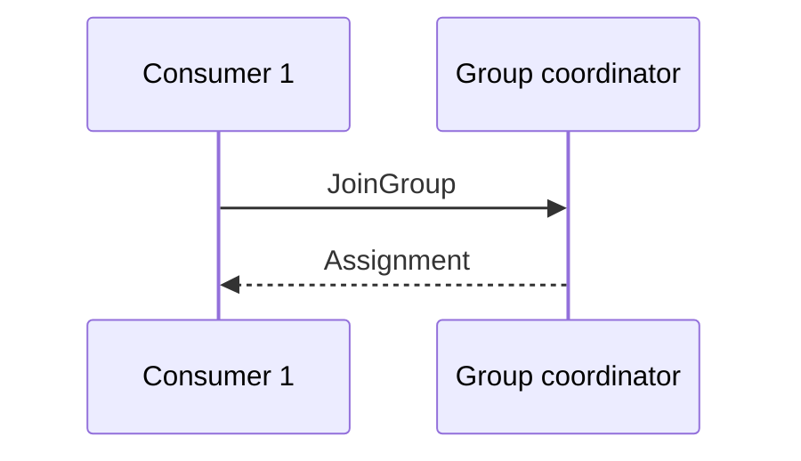

# Writing articles

Each article is a folder in `src/content/blogs/`. The folder name is the URL:
`src/content/blogs/kafka_consumer_groups/index.mdx` is served at
`/blog/kafka_consumer_groups`. Never rename a published folder; add a redirect
in `vercel.json` if you must.

```
src/content/blogs/kafka_consumer_groups/
├── index.mdx
├── rebalance.light.svg
└── rebalance.dark.svg
```

Articles are MDX: Markdown plus a few components. Everything below works
without imports, except your own image files.

## Frontmatter

```yaml
---
title: 'How Kafka Consumer Groups Rebalance'
date: '2026-12-01' # YYYY-MM-DD, required
summary: 'One or two sentences. Shown under the title and as the meta description.'
tags: ['Kafka', 'Distributed Systems']
updated: '2026-12-15' # optional, shows "Updated …"
readTime: '12 min read' # optional, computed from the word count otherwise
series: 'Kafka Internals' # optional
seriesOrder: 2 # required with series
---
```

Don't repeat the title as a `# Heading` in the body; the page renders it. Start
sections at `##`. Every `##` appears in "On this page"; `###` headings appear
under the section being read.

Posts in a series link to each other in series order and show "Part 2 of 3".
Other posts link to the previous and next post by date.

## Code

````md
```java title="OrderService.java" {4-6}
@Service
public class OrderService {
    // lines 4–6 are highlighted
}
```
````

| Want                 | Write                                              |
| -------------------- | -------------------------------------------------- |
| File name in the bar | `title="OrderService.java"`                        |
| Highlight lines      | `{4-6}` or `{2,5}`                                 |
| Line numbers         | `showLineNumbers`                                  |
| Show a change        | end a line with `// [!code ++]` or `// [!code --]` |
| Highlight one line   | end it with `// [!code highlight]`                 |
| Highlight a word     | `/repo/` in the fence meta                         |
| Plain text / output  | ` ```text ` (or no language)                       |

Any language Shiki knows works (java, kotlin, go, sql, yaml, bash, json, ts…).
Highlighting happens at build time, so it costs readers nothing. "Copy" leaves
out lines marked `--`.

## Diagrams

**Flows, sequences and state machines: Mermaid.** It is drawn in the reader's
theme and opens full size on click.

````md

````

In a flowchart, `class NodeId key` outlines the node the text is about in the
accent colour.

**Architecture diagrams: draw them, export SVG.** Mermaid is poor at box-and-
arrow architecture. Draw in Excalidraw (or draw.io), export twice (light and
dark background), and use `<Figure>`:

```mdx
import rebalanceLight from './rebalance.light.svg';
import rebalanceDark from './rebalance.dark.svg';

<Figure
  light={rebalanceLight}
  dark={rebalanceDark}
  alt="Three consumers in one group, each owning two of six partitions"
  caption="Partition ownership before the rebalance."
/>
```

Excalidraw: Export image → SVG, tick "Embed scene" so you can re-edit later,
and export once with the dark-mode toggle on.

## Images

```mdx
import dashboard from './latency-dashboard.png';

<Figure
  src={dashboard}
  alt="p99 latency drops from 480 ms to 120 ms after the change"
  caption="p99 latency, a week either side of the release."
/>
```

`alt` is required: say what the image shows, not what it is. Figures open full
screen on click; pass `zoom={false}` for small images. Plain ``
also works for remote images, without a caption.

## Callouts

```md
> [!NOTE]
> Background the reader may want.

> [!TIP]
> A better way to do it.

> [!IMPORTANT]
> Must not be missed.

> [!WARNING]
> Will break something.
```

This is GitHub's alert syntax, so the file still reads well on GitHub. For a
custom label: `<Callout type="tip" title="Rule of thumb">…</Callout>`.

## MDX gotchas

- `{` and `<` in prose start an expression or a tag. Wrap them in backticks,
  or escape them: `\{`, `&lt;`.
- HTML comments (`<!-- -->`) don't work; use `{/* comment */}`.
- `npm run build` fails on a syntax error and names the file and line.
